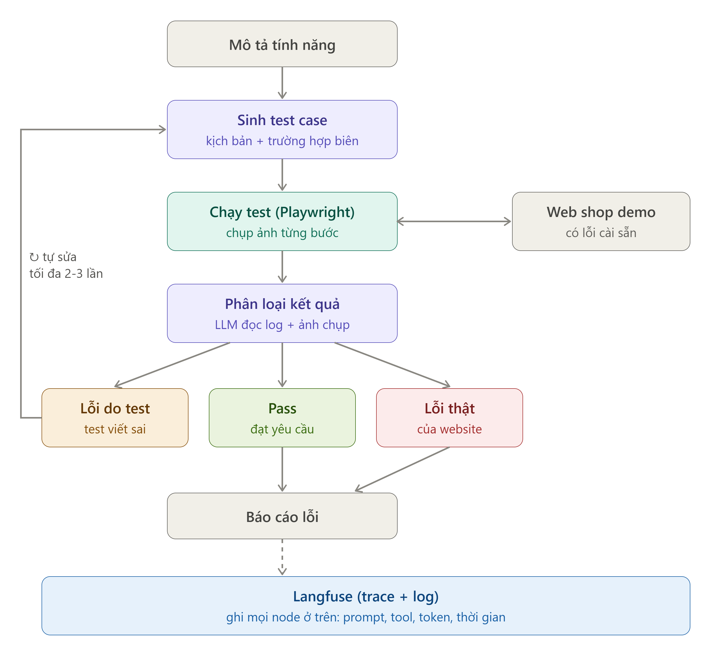
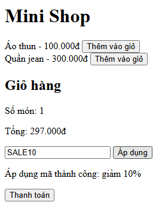
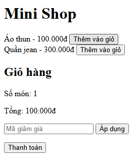
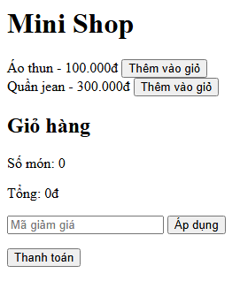

# ShopQA-Agent

Agent AI tự **sinh, chạy và kiểm tra test E2E** cho website thương mại điện tử từ một file mô tả tính năng.
Xây bằng **LangGraph + Playwright + LLM (Gemini)**, có shop demo với lỗi cài sẵn để đo xem agent bắt được lỗi hay không.

> **Trạng thái:** MVP chạy được từ đầu đến cuối (sinh test, chạy bằng trình duyệt thật, báo lỗi kèm ảnh chụp).
> Đã có phân loại bằng LLM, vòng tự sửa test, tích hợp Langfuse và script đo tự động; số liệu đo còn đang bổ sung,
> xem mục [Trạng thái và kế hoạch](#trạng-thái-và-kế-hoạch).
> Mã nguồn nằm trong thư mục `shopqa-agent/`.

## Ý tưởng

Một bạn QA đọc yêu cầu, tự viết danh sách việc cần kiểm tra, bấm thử trên website rồi ghi lại cái nào hỏng.
ShopQA-Agent làm đúng quy trình đó:

1. Đọc **file spec** mô tả tính năng (vd `specs/checkout.md`).
2. Mở trang thật, **liệt kê các phần tử UI** đang có (nút, ô nhập, `data-testid`).
3. LLM sinh các **test case** dưới dạng JSON, chỉ được dùng phần tử có thật.
4. Playwright **chạy từng bước** trong trình duyệt sạch, chụp ảnh từng bước.
5. Báo test nào pass, test nào fail, kèm bước hỏng, loại lỗi và ảnh.

## Kiến trúc



*Sơ đồ luồng. Mức hoàn thiện của từng node xem bảng bên dưới.*

| Node | Việc làm | Trạng thái |
|---|---|---|
| `generate_tests` | LLM sinh test dạng JSON, kiểm tra schema bằng pydantic, tự thử lại tối đa 3 lần nếu JSON sai | Xong |
| `run_tests` | Playwright chạy từng bước, mỗi test một trình duyệt sạch, chụp ảnh từng bước | Xong |
| `classify` | Phân loại pass / lỗi thật / lỗi do test / chưa rõ (`inconclusive`) | Có: `invalid_action` xử lý bằng quy tắc, các lỗi còn lại do LLM phân tích; lỗi API thì ghi `inconclusive`. Mới kiểm thử bằng LLM giả |
| `repair_test` | LLM sửa test bị phân loại là lỗi do test, chạy lại tối đa 3 lần | Có: kiểm tra action hợp lệ, giữ nguyên test cũ nếu LLM lỗi. Mới kiểm thử bằng LLM giả |
| `report` | Tổng hợp kết quả | Tạm: danh sách đơn giản |
| Langfuse (`tracing.py`) | Ghi trace từng node và lần gọi LLM | Có, tùy chọn (tự tắt nếu không có khóa) |

`graph.py` dựng hai phiên bản để so sánh: **A** (không tự sửa) và **B** (có vòng tự sửa).

### Các quyết định thiết kế

- **Test là danh sách action có cấu trúc, không phải code LLM viết.** Các action gồm `goto`, `click`, `fill`, `select`,
  `expect_text`, `expect_visible`, `expect_enabled`, `expect_disabled`, `expect_url`... Nhờ vậy không phải `exec()` code lạ,
  mỗi bước log được riêng, và việc sửa test chỉ là sửa vài dòng JSON.
- **LLM "nghĩ", code cố định "chạy".** Phần chạy test không dùng LLM nên agent không thể tự nhận là pass,
  kết quả lặp lại được và đo được.
- **Chống bịa selector.** Trước khi sinh test, agent mở trang thật và đưa cho LLM danh sách phần tử UI làm nguồn duy nhất được dùng.
- **Phân biệt loại lỗi.** Mỗi test fail có `error_type`: `assertion_failed` (có phần tử nhưng nội dung sai, tín hiệu mạnh của lỗi thật),
  `element_not_found` (selector sai hoặc web thiếu phần tử), `navigation_error`, `invalid_action`...
- **Shop demo có lỗi cài sẵn**, bật bằng tham số trên địa chỉ: `?bug=coupon`, `?bug=checkout`.

## Kết quả đo

Thiết lập: model `gemini-3.8-flash`, nhiệt độ 0, shop `mini_shop`, spec `specs/checkout.md`.
Số liệu hiện còn ít (mỗi chế độ mới 1 lần chạy), đọc như dữ liệu ban đầu chứ chưa phải kết luận thống kê.

### Đo tự động (`evals/run_many.py`)

Bảng dưới được tạo từ `shopqa-agent/evals/results/runs.csv`. Lần chạy bị lỗi API không tính vào mẫu số.

<!-- RESULTS:START -->
| Prompt | Phiên bản | Chế độ | Số lần chạy | Bắt được lỗi | Báo nhầm | Lần lỗi API (không tính) |
|---|---|---|---|---|---|---|
| sau-sua | B | checkout | 1 | 1/1 (100%) | - | 0 |
| sau-sua | B | clean | 1 | - | 0/1 (0%) | 0 |
| sau-sua | B | coupon | 1 | 1/1 (100%) | - | 0 |
<!-- RESULTS:END -->

### Lịch sử cải tiến prompt (chạy tay, trước khi có script đo)

| Chế độ | Prompt | Số lần chạy | Kết quả |
|---|---|---|---|
| `bug=coupon` (giảm 1% thay vì 10%) | ban đầu | 1 | **Bỏ sót lỗi**: test chỉ kiểm tra thông báo "Áp dụng thành công", tổng 99.000đ vẫn PASS |
| `bug=coupon` | thêm quy tắc "phải tự tính và kiểm tra con số kỳ vọng" | 7 | **Bắt được 7/7**, đều `assertion_failed` |
| Shop sạch (không có lỗi) | ban đầu | 1 | 6/6 PASS, 0 báo nhầm |

Ví dụ báo cáo của một lần chạy `bug=coupon`:

```
[FAIL] t3: Áp dụng mã giảm giá SALE10 thành công
- t3: real_bug phần tử có nhưng kết quả khác kỳ vọng
    ✗ 6. expect_text [data-testid="cart-total"] = 'Tổng: 90.000đ' -> assertion_failed:
      kỳ vọng chứa 'Tổng: 90.000đ', thực tế là 'tổng: 99.000đ'
```

**Bài học rút ra:** lần chạy đầu agent bỏ sót lỗi không phải vì phần chạy test sai, mà vì LLM sinh test chưa đủ chặt.
Thêm hai quy tắc vào prompt (kiểm tra con số tính được, mỗi điểm của spec cần ít nhất một test kiểm tra kết quả của chính nó)
đã khắc phục trong các lần chạy sau. Số liệu từng lần chạy nằm ở `shopqa-agent/evals/results/runs.csv`.

## Bằng chứng

<!-- EVIDENCE:START -->
**Lỗi mã giảm giá (`?bug=coupon`: giảm 1% thay vì 10%)**

| Shop có lỗi | Shop đúng |
|:---:|:---:|
|  |  |

> Agent báo: `✗ 6. expect_text [data-testid="cart-total"] = '270.000đ' -> assertion_failed: kỳ vọng chứa '270.000đ', thực tế là 'tổng: 297.000đ'`

**Lỗi nút thanh toán (`?bug=checkout`: không bị vô hiệu khi giỏ trống)**

| Shop có lỗi | Shop đúng |
|:---:|:---:|
|  |  |

> Agent báo: `✗ 4. expect_disabled [data-testid="checkout-button"] -> assertion_failed: [data-testid="checkout-button"] đang bật, trái với kỳ vọng`
<!-- EVIDENCE:END -->

## Chạy thử

Yêu cầu: Python 3.10 trở lên và một khóa API của nhà cung cấp LLM (mặc định dùng Gemini).

```bash
cd shopqa-agent
python -m venv .venv
# Windows PowerShell:  .venv\Scripts\Activate.ps1      macOS/Linux:  source .venv/bin/activate
pip install -r requirements.txt
playwright install chromium
```

Tạo file `.env` (sao chép từ `.env.example`) và điền:

```
LLM_PROVIDER=google
LLM_MODEL=<tên model Gemini>
GOOGLE_API_KEY=<khóa của bạn>
```

Dùng nhà cung cấp khác thì cài thêm gói tương ứng (`langchain-anthropic`, `langchain-openai`, `langchain-ollama`)
và đổi `LLM_PROVIDER` (`anthropic`, `openai`, `ollama`).

**Cửa sổ 1: bật shop demo**

```bash
cd demo_shop/mini_shop
python -m http.server 8000
```

**Cửa sổ 2: chạy agent**

```powershell
# Windows PowerShell
$env:PYTHONPATH = "src"
python -m shopqa.cli --spec specs/checkout.md --base-url "http://localhost:8000"
```

```bash
# macOS / Linux
export PYTHONPATH=src
python -m shopqa.cli --spec specs/checkout.md --base-url "http://localhost:8000"
```

Bật lỗi cài sẵn bằng cách thêm tham số vào địa chỉ:

```
--base-url "http://localhost:8000/?bug=coupon"      # giảm giá sai
--base-url "http://localhost:8000/?bug=checkout"    # nút thanh toán không bị vô hiệu khi giỏ trống
```

Dùng `--no-self-repair` để chạy phiên bản A. Ảnh chụp từng bước và `run.json` được lưu trong `artifacts/<thời gian>/`.

### Đo tự động nhiều lần

`evals/run_many.py` chạy agent lặp lại theo từng chế độ lỗi, ghi mỗi lần chạy vào `evals/results/runs.csv` và in bảng tổng hợp:

```bash
python evals/run_many.py --runs 5 --prompt-version sau-sua                  # cả 3 chế độ (coupon, checkout, clean)
python evals/run_many.py --modes checkout clean --runs 5 --variants A B     # so sánh phiên bản A và B
python evals/run_many.py --summary                                           # chỉ in lại bảng từ file CSV
```

- **Bắt được lỗi:** có test FAIL (`assertion_failed`) đúng vào phần tử của lỗi cài sẵn. **Báo nhầm:** shop sạch mà có test FAIL.
  Hai chỉ số này tính từ kết quả chạy trình duyệt, không phụ thuộc vào node `classify`.
- Lần chạy bị lỗi API (quá tải, hết hạn mức) được ghi riêng và **không tính vào mẫu số**; gặp hết hạn mức thì script tự dừng để khỏi tốn thêm lượt gọi.
- Lỗi cài đặt (thiếu gói, sai môi trường Python) làm script dừng ngay và **không** ghi vào CSV. Nếu CSV đã có các dòng như vậy,
  dọn bằng `python evals/run_many.py --drop-setup-errors`.
- Ghi bảng kết quả thẳng vào README: `python evals/run_many.py --summary --update-readme ../README.md`.
- Tạo ảnh bằng chứng (ảnh chụp lúc agent bắt được lỗi, đặt cạnh ảnh cùng bước trên shop đúng) và ghi vào README:
  `python evals/collect_evidence.py --update-readme ../README.md`.
- Mỗi lần chạy gọi LLM ít nhất một lần (sinh test), thêm một lần cho mỗi test FAIL (phân loại) và cho mỗi lượt sửa, nên 15 lần chạy có thể tốn khá nhiều hạn mức.

### Langfuse (tùy chọn)

Điền khóa của một project Langfuse vào `.env` là agent tự ghi trace (lọc theo tag chế độ, phiên bản, model; gom theo `run_id`):

```
LANGFUSE_PUBLIC_KEY=pk-lf-...
LANGFUSE_SECRET_KEY=sk-lf-...
LANGFUSE_BASE_URL=https://cloud.langfuse.com
```

Không có khóa hoặc đặt `SHOPQA_TRACING=0` thì agent chạy bình thường. Lỗi của Langfuse không làm hỏng lần chạy.
Lưu ý: trace chứa prompt và nội dung trang, chỉ nên dùng với dữ liệu demo.

**Chạy kiểm thử của chính project** (cần Chromium; không cần khóa API):

```bash
pytest
```

## Cấu hình (`.env`)

| Biến | Ý nghĩa | Mặc định |
|---|---|---|
| `LLM_PROVIDER` | `google`, `anthropic`, `openai`, `ollama` | `anthropic` |
| `LLM_MODEL` | tên model của nhà cung cấp (bắt buộc) | |
| `SHOPQA_LLM_TIMEOUT` | số giây chờ tối đa cho mỗi lần gọi LLM | `60` |
| `SHOPQA_LLM_RETRIES` | số lần tự thử lại khi lỗi tạm thời (quá tải, hết hạn mức) | `2` |
| `SHOPQA_MAX_TESTS` | số test tối đa mỗi lần sinh | `6` |
| `SHOPQA_TIMEOUT_MS` | thời gian chờ tối đa cho mỗi bước trình duyệt | `5000` |
| `SHOPQA_HEADLESS` | `0` để xem trình duyệt chạy thật | `1` |
| `SHOPQA_ARTIFACTS` | thư mục lưu ảnh và kết quả | `artifacts` |
| `LANGFUSE_PUBLIC_KEY`, `LANGFUSE_SECRET_KEY` | khóa Langfuse; điền cả hai để bật trace | trống (tắt) |
| `LANGFUSE_BASE_URL` | địa chỉ Langfuse (`https://us.cloud.langfuse.com` nếu project ở vùng Mỹ) | `https://cloud.langfuse.com` |
| `SHOPQA_TRACING` | `0` để tắt trace dù đã có khóa | bật |

## Cấu trúc thư mục

```
shopqa-agent/
├── src/shopqa/
│   ├── graph.py          # dựng đồ thị LangGraph (phiên bản A/B)
│   ├── state.py          # state chạy qua các node
│   ├── schemas.py        # kiểm tra JSON do LLM sinh ra
│   ├── llm.py            # chọn nhà cung cấp LLM theo .env
│   ├── cli.py, log.py    # chạy từ dòng lệnh, in tiến độ
│   ├── tracing.py        # tích hợp Langfuse (tùy chọn)
│   ├── nodes/            # generate_tests, run_tests, stubs (classify, repair_test, report)
│   ├── prompts/          # prompt tách riêng khỏi code
│   └── tools/browser.py  # hàm bọc Playwright, đọc phần tử UI
├── evals/                # run_many.py (chạy lặp, đo tỉ lệ bắt lỗi / báo nhầm, ghi CSV), collect_evidence.py (ảnh bằng chứng)
├── demo_shop/mini_shop/  # shop demo một trang, có lỗi cài sẵn
├── specs/checkout.md     # mô tả tính năng làm đầu vào cho agent
├── tests/                # 56 test pytest (LLM giả + trình duyệt thật)
└── docs/                 # sơ đồ và bảng số liệu
```

## Hạn chế hiện tại

- **Số liệu còn ít** và chỉ dùng một model; LLM sinh bộ test khác nhau mỗi lần nên kết quả có thể dao động.
- **Shop demo nhỏ** (một trang, hai lỗi cài sẵn), chưa phản ánh website thật.
- **`classify` và `repair_test` mới được kiểm thử bằng LLM giả**, chưa đánh giá chất lượng với Gemini thật.
- **Chưa có chốt chặn cho vòng tự sửa:** `classify` gửi cả lỗi `assertion_failed` cho LLM, nên LLM phân loại nhầm lỗi thật thành lỗi do test
  thì `repair_test` có thể sửa test cho khớp với web sai và che mất lỗi. Khi API lỗi, lỗi thật bị ghi thành `inconclusive`.
  Chỉ số "bắt được lỗi" của `evals/run_many.py` tính trực tiếp từ kết quả chạy nên vẫn đo được hiện tượng này.
- **Vòng tự sửa chưa có việc để làm trên shop demo hiện tại:** selector lấy từ trang thật nên hiếm khi có lỗi do test, phiên bản A và B sẽ cho kết quả gần như nhau.
- Chưa chạy trên các sàn thương mại điện tử thật (có thể vi phạm điều khoản sử dụng); chỉ dùng shop demo.

## Trạng thái và kế hoạch

- [x] Sinh test bằng LLM, kiểm tra schema, thử lại khi sai
- [x] Chạy test bằng Playwright, chụp ảnh, phân loại loại lỗi
- [x] Shop demo với lỗi cài sẵn và bộ kiểm thử tự động (56 test)
- [x] Đo ban đầu cho `bug=coupon`
- [x] `classify` kết hợp quy tắc và LLM; `repair_test` tự sửa test rồi chạy lại (kiểm thử bằng LLM giả)
- [x] Tích hợp Langfuse (tùy chọn)
- [x] Script đo tự động `evals/run_many.py` (tỉ lệ bắt lỗi, báo nhầm, so sánh phiên bản A/B)
- [x] Đo bước đầu cả 3 chế độ (mỗi chế độ 1 lần)
- [x] Công cụ tạo ảnh bằng chứng từ các lần đo
- [ ] Đo đủ cỡ mẫu (khoảng 5 lần mỗi chế độ) để tỉ lệ có ý nghĩa
- [ ] Ảnh trace trên Langfuse
- [ ] Chốt chặn cho vòng tự sửa: `assertion_failed` luôn là lỗi thật theo quy tắc; `repair_test` không được làm yếu assertion
- [ ] Kịch bản UI thay đổi (ví dụ shop đổi tên `data-testid`) để vòng tự sửa có việc làm, rồi so sánh A với B
- [ ] Bộ lỗi cài sẵn lớn hơn (15-20 lỗi)
- [ ] `classify` đọc cả ảnh chụp, `report` chi tiết hơn (mức độ nghiêm trọng, bước tái hiện)

## Công nghệ

Python, LangGraph, LangChain, Playwright, pydantic, pytest, Gemini API.
